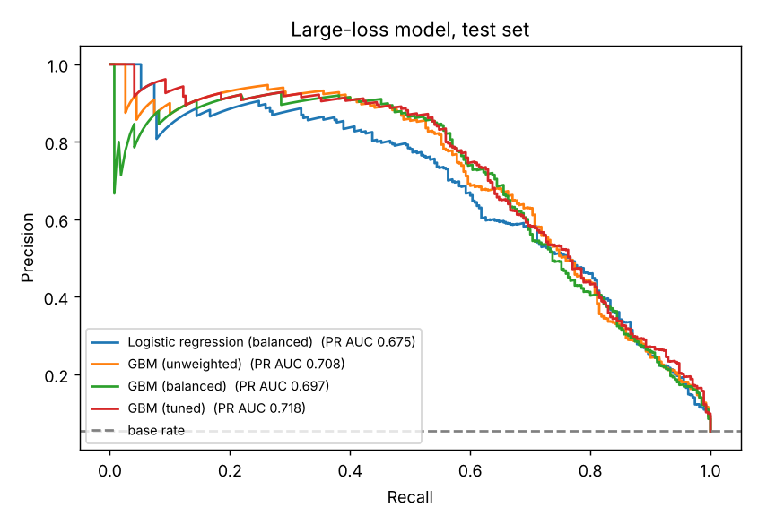
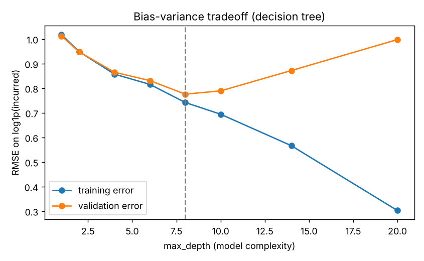

# FNOL Claims Triage on Databricks


Predict, at **First Notice of Loss**, which commercial P&C claims will become **large losses** (12-month incurred of $50,000 or more), and route them to the right adjuster on day one.

End to end on Databricks: Unity Catalog feature table, MLflow tracking, hyperparameter tuning, Unity Catalog model registry with champion/challenger aliases, batch and streaming scoring, a custom real-time serving endpoint with a traffic split, and a scheduled retraining job deployed with a bundle.

> All data is **synthetic** and generated in code with a fixed seed (`src/claims_triage/data.py`). Programs, MGAs, insureds and amounts are fictional.

## Why this problem

A small share of claims drives most of the loss dollars. When an attorney is already involved at FNOL, an injury is reported, or the loss is a coastal wind or underinsured fire claim, the claim often grows well past its initial reserve. Spotting those claims at intake lets a carrier assign senior adjusters early, set adequate reserves, and engage defense counsel sooner.

## Results (synthetic data, held-out test set)

| Model | PR AUC | ROC AUC | Log loss | Precision @0.5 | Recall @0.5 |
|---|---|---|---|---|---|
| Logistic regression, balanced weights (baseline) | 0.675 | 0.954 | 0.261 | 0.32 | 0.87 |
| Gradient-boosted trees, unweighted | 0.708 | 0.957 | 0.095 | 0.82 | 0.54 |
| Gradient-boosted trees, balanced weights | 0.697 | 0.956 | 0.199 | 0.40 | 0.82 |
| **Gradient-boosted trees, tuned** (champion) | **0.718** | **0.960** | **0.092** | 0.85 | 0.54 |

Base rate: about 5% of claims are large losses. PR AUC is the primary metric because positives are rare; accuracy is not reported because predicting "not large" for everything would score 95%.

**What it means for the claims team** (tuned model, test claims):

| Triage tier | Share of claims | Share of all large losses caught | Large-loss rate in tier |
|---|---|---|---|
| HIGH (p ≥ 0.50) | 3.4% | 54% | 85% |
| ELEVATED (0.20 to 0.50) | 2.2% | 13% | 31% |
| STANDARD | 94.5% | 33% | 2% |

Reviewing the top **5.6%** of claims surfaces **two thirds** of the large losses.

<p float="left">
  
  
</p>

Severity companion model (log target, metrics in dollars after `expm1`): RMSE $28.2k, MAE $8.4k, R² 0.55.

Numbers come from running the same code locally; your Databricks run should land within a point or two.

## Architecture

```mermaid
flowchart LR
  subgraph Data
    RP[raw_policies] --> FT[(policy_features<br/>UC feature table<br/>PK policy_id)]
    RC[raw_claims] --> TB[claims_training_base]
    RC --> TS[claims_to_score]
  end
  subgraph Training
    TB --> L[FeatureLookup +<br/>create_training_set]
    FT --> L
    L --> M[sklearn pipelines<br/>logreg / GBM]
    M --> H[Hyperopt / Optuna /<br/>GridSearchCV]
    M --> MF[(MLflow experiment)]
    H --> MF
  end
  subgraph Registry
    MF --> R[(UC model<br/>fnol_large_loss)]
    R --> A{champion vs<br/>challenger gate}
    A -->|PR AUC +0.005| C[@champion]
  end
  subgraph Inference
    C --> B[fe.score_batch<br/>claims_triage_scores]
    C --> S[spark_udf in a<br/>declarative pipeline]
    C --> E[Model Serving endpoint<br/>custom pyfunc, 90/10 split]
  end
```

## Repository layout

```
src/claims_triage/        tested Python package used by notebooks and jobs
  data.py                 deterministic synthetic portfolio
  features.py             feature lists, outlier fences, sklearn preprocessing (linear vs tree)
  train.py                logistic baseline, GBM classifier, GBM severity regressor
  evaluation.py           classification/regression metrics, grid-size math, champion gate
  splits.py               CRC-32 split that matches in Python and Spark
  triage.py               tiers, reason codes, custom MLflow pyfunc models
  tracking.py             training-set loading via FeatureLookup, run logging, alias evaluation
src/pipelines/            streaming scoring as a Lakeflow declarative pipeline
notebooks/                00 to 07, the walkthrough (below)
jobs/                     retraining job tasks (deploy-code MLOps)
resources/retrain_job.yml job definition: refresh features, retrain, gate, batch score
databricks.yml            bundle with dev and prod targets
conf/best_params.json     tuned hyperparameters used by the retraining job
tests/                    pytest suite run by GitHub Actions
```

## Notebooks

| # | Notebook | What it does |
|---|---|---|
| 00 | `00_setup_data` | Generates 20k policies and 40k claims; splits into a training base (pre-2026) and claims to score (2026) |
| 01 | `01_eda_data_prep` | Summary stats, data profile, outliers (sd vs IQR), correlation and chi-square, imputation choices, one-hot vs ordinal, log transform |
| 02 | `02_feature_store` | Creates the UC feature table with `FeatureEngineeringClient`, merges updates, offline vs online |
| 03 | `03_train_track` | Training sets via `FeatureLookup`; three candidates logged to MLflow; best run via `search_runs`; tier analysis |
| 03b | `03b_severity_regression` | Log-target regression, dollar metrics, bias-variance curve |
| 04 | `04_tuning` | GridSearchCV (and model counting), Hyperopt `fmin`, Optuna, Spark ML `CrossValidator` |
| 05 | `05_register_promote` | UC registration, tags, champion/challenger aliases, gate with `fe.score_batch` |
| 06 | `06_batch_streaming_inference` | pandas, `spark_udf`, and `fe.score_batch` scoring; streaming pipeline setup |
| 07 | `07_model_serving` | Custom pyfunc (probability, tier, reason codes), endpoint with 90/10 traffic split, query, cleanup |
| 08 | `08_automl_reference` | AutoML classification baseline (needs classic ML-runtime compute; reference on Free Edition) |

## Run it

**Databricks Free Edition works** (serverless). You need a GitHub account.

1. Fork or clone this repo to your GitHub account.
2. In Databricks: **Settings > Linked accounts**, connect GitHub. Then **Workspace > Create > Git folder** with the repo URL.
3. Open `notebooks/00_setup_data`, attach **Serverless**, and run all. Then run 01 to 07 in order.
   - The defaults write to `workspace.claims_ml`. Change the `catalog` / `schema` widgets at the top of any notebook to use another location.
   - Notebook 07 creates a serving endpoint and deletes it at the end. Free Edition limits active endpoints.
4. Optional, MLOps: install the Databricks CLI, then
   ```bash
   databricks auth login --host https://<your-workspace>
   databricks bundle validate
   databricks bundle deploy -t dev
   databricks bundle run -t dev fnol_triage_retrain
   ```
   The dev target writes to `claims_ml_dev` and bootstraps its own data on the first run.

Local tests (no Databricks needed):

```bash
pip install -e ".[dev]"
ruff check . && pytest -q
```

## Troubleshooting

| Symptom | Fix |
|---|---|
| `Could not find src/claims_triage` | Open the notebooks from the cloned Git folder, not a copy |
| `log_model() got an unexpected keyword argument 'code_path'` | Version mismatch between `databricks-feature-engineering` and MLflow. Change the `%pip` line to `databricks-feature-engineering==0.12.1` |
| `fe.score_batch failed ... Falling back` printed | Expected fallback: scoring continues with a feature join and the `proba_model` Spark UDF |
| Endpoint creation fails with a quota message | Free Edition limits serving endpoints. Delete other endpoints or read notebook 07 as reference |
| `databricks.automl` not available | AutoML needs classic compute with an ML runtime; notebook 08 is reference on Free Edition |

## Design decisions

- **PR AUC as the primary metric.** Positives are about 5% of claims. ROC AUC is high for every model on imbalanced data; PR AUC separates them.
- **Thresholds over class weights.** Balanced class weights raise recall at 0.5 but distort probabilities (log loss more than doubles). The champion is unweighted, and the business sets tier thresholds on calibrated-looking probabilities instead.
- **Policy features in a UC feature table; claim fields passed at FNOL.** Policy attributes are reused across models and governed once. Logging with `fe.log_model` means batch scoring needs only `policy_id` and the FNOL fields, so training and scoring features cannot drift apart.
- **Median imputation, ordinal categories for trees, one-hot plus log transforms for the linear baseline.** Choices come from the EDA in notebook 01 and live in `build_preprocessor()` so they are applied identically everywhere.
- **Deterministic split by claim_id (CRC-32).** Notebooks, the retraining job, and tests agree on the held-out set without storing a split table.
- **Champion/challenger gate.** A retrained model is promoted only if it beats the current champion's PR AUC on the same test claims by at least 0.005; the old champion keeps a `@previous_champion` alias for one-step rollback.
- **Deploy code, not models.** The retraining job is deployed to each environment with a bundle and retrains on that environment's data.
- **Self-contained custom models.** `cloudpickle.register_pickle_by_value` bundles the package code into logged pyfunc models, so the serving endpoint does not need this repo installed.

## Databricks Machine Learning Associate exam coverage

| Exam section | Where |
|---|---|
| 1. Databricks ML (MLOps, ML runtimes, AutoML, feature store in UC, MLflow tracking, UC registry, tags, aliases) | 02, 03, 05, 08, `jobs/`, `databricks.yml` |
| 2. Data processing (summary stats, outliers, visualization, comparisons, imputation, one-hot, log transforms) | 01 |
| 3. Model development (algorithm choice, imbalance, estimators/transformers, pipelines, Hyperopt, grid/random/Bayesian, CV and model counts, metrics, log targets, bias/variance) | 03, 03b, 04 |
| 4. Deployment (batch vs streaming vs real time, pandas batch, streaming with declarative pipelines, custom model serving, querying, traffic splitting) | 06, 07 |

## Limitations and next steps

- Synthetic data: relationships are designed, so absolute metrics are optimistic compared with a real book.
- No drift monitoring yet (data profiling on `claims_triage_scores` and on the feature table is the natural next step).
- Probabilities are not explicitly calibrated; isotonic calibration on the validation set would make tier thresholds more stable.
- Reason codes are rule based. SHAP values per claim would give model-based explanations.
- The severity model's `expm1` back-transform underestimates the mean; a smearing correction would fix that for reserving use.

## Author

Derek Edgar · [LinkedIn](https://www.linkedin.com/in/derek-edgar)

MIT licensed.
